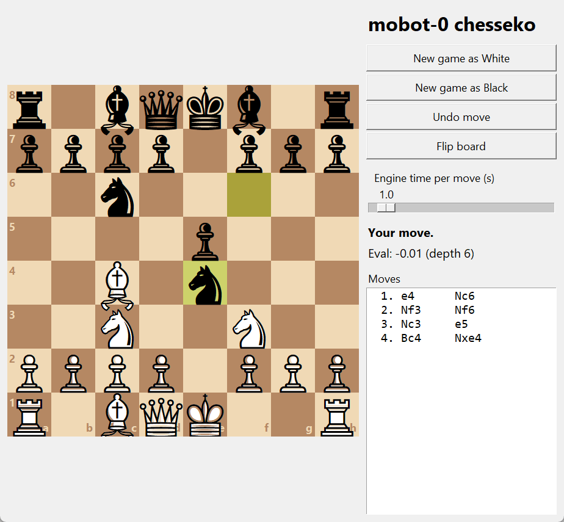

# mobot-0 chesseko

A chess engine written from scratch in pure Python (standard library only, Python 3.8+).
It plays full legal chess and searches with alpha-beta plus the usual pruning tricks.



## Usage

```
python gui.py      # play in a window
python play.py     # play in the terminal
python uci.py      # UCI engine for Arena, Cute Chess, lichess-bot, etc.
python -m unittest tests -v
```

## Files

- `board.py`: board, move generation, FEN/SAN, draw rules
- `evaluate.py`: piece-square evaluation
- `search.py`: alpha-beta search
- `uci.py`, `play.py`, `gui.py`: the UCI, terminal and window front ends
- `tests.py`: perft and tactical tests
